<h2>Hey, I'm Adx!</h2>

AI/ML Developer in Toronto. I build AI agents, n8n automations, and LLM pipelines that run real business workflows.

  

<h3 align="left">What I build</h3>

* Lead intake automations that dedupe, score, and route leads into a CRM
* AI agents with a human in the loop for review and approval
* RFP intelligence that turns long documents into structured requirements and evidence matches
* WhatsApp assistants for enrollment and lead qualification

<!-- ACTIVITY:START -->
### Recently updated projects

* [personal_portfolio](https://github.com/adx7893/personal_portfolio): JavaScript
* [Hirerig](https://github.com/adx7893/Hirerig): TypeScript
* [SAP_SOL_AI_Agent](https://github.com/adx7893/SAP_SOL_AI_Agent): Blade
* [react_to_angular](https://github.com/adx7893/react_to_angular): TypeScript
* [portfolio_web_app](https://github.com/adx7893/portfolio_web_app): TypeScript

Auto updated on Nov 16, 2026
<!-- ACTIVITY:END -->

   📫 How to reach me: <strong>apurvakansara5@gmail.com</strong>

   

<h3 align="left">Languages and Tools:</h3>

   
   
   
   
   
   
   

